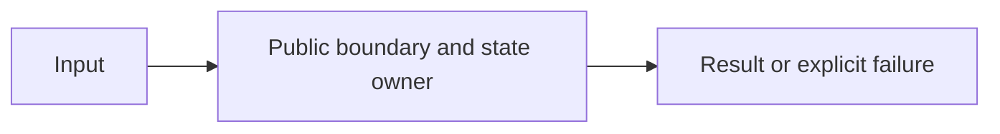
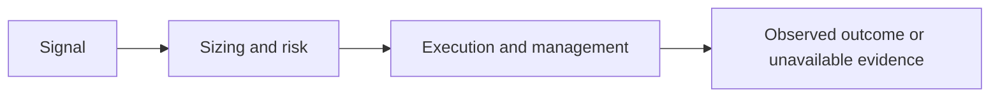

<!-- This repository and PR are public. Complete before independent QA using public-safe
facts only. Never copy private configurations, strategy rules, research IDs/hashes,
filesystem paths, raw journals, market history, credentials or real account data. -->

## Problem and actual change

- Problem / approved public scope:
- Technical changes: page, presentation, exporter interface or documentation:
- Trading strategy / parameters / risk: explicitly unchanged, or give an approved public-safe
  summary of changes; keep private details in the authorized private review:
- Before -> after: concrete visitor-visible effect, compatibility, limits and exclusions:
- Simulated results or selection changes: public-safe provenance, comparison limits and approval:

## Technical changes

Describe actual affected modules/interfaces, input/output, state owner, dependencies and failure paths. Cite exact repository base/head source paths and relevant lines; public PRs cite public source only. Keep changed and preserved paths explicit. Diagrams below are conceptual authoring placeholders, not claims of implemented or deployed behavior. Replace them with source-backed flows; label actual implementation and separately verified deployment state.

### Before (old flow)

Conceptual placeholder; replace with exact base reference and label unchanged paths.

### After (new flow)

Conceptual placeholder; replace with exact head reference. Match node IDs/structure/labels to Before where useful; identify changed edges and preserved paths.

| Area | Before | After | Effect |
| --- | --- | --- | --- |
| Technical behavior | Exact base behavior | Actual head behavior | Source evidence and limits |
| Failure, state and compatibility | Exact base path | Changed or preserved path | Evidence and limits |

# Trading-strategy changes

State this diff's actual signal, parameter, sizing, risk, execution and results effects, or explicitly unchanged and why. Use identical node IDs/structure in the paired strategy diagrams. When behavior is unchanged, label BOTH diagrams and all preserved paths **unchanged**. Cite exact base/head source evidence; no change in results is inferred from docs or diagrams. Public descriptions stay public-safe; keep private source, strategy rules and research identities in authorized private review.

### Before (old strategy flow)

Conceptual placeholder, exact base reference required; mark unchanged explicitly when applicable.

### After (new strategy flow)

Conceptual placeholder, exact head reference required; when behavior is unchanged label this diagram unchanged too, retaining the same structure. Distinguish conceptual, implemented and separately verified deployed state.

| Area | Before | After | Effect |
| --- | --- | --- | --- |
| Trading-strategy behavior | Exact base rules/assumptions | Diff-specific changes, or explicitly unchanged | Evidence and limits; no invented results |

Use graphs only for sourced actual measurements with producing identity, date/window, sample, comparable conditions, units and scope. If absent: No measured data; graph omitted. Record Mermaid parser/version and GitHub rendering result, or NOT RUN with reason. Diagrams do not grant operational authority.

## Validation and evidence

Public repository base SHA / tested head or tree / browser or validation environment:

| Check / exact public-safe command or procedure | Result and coverage | Public-safe evidence / limits |
| --- | --- | --- |
| Diff, docs, relative links and whitespace | | |
| Offline page navigation, filters, charts and details where affected | | |
| Export reconciliation and decompressed-payload privacy where affected | | |
| Independent QA (reviewer and exact public reviewed SHA) | Pending unless evidenced | |

Use PASS, FAIL, NOT RUN or N/A with a reason; include dates, counts and sampled coverage.
This repository has no package/test command; do not invent one. For private exporter
validation, report only an approved public-safe outcome; keep private receipts private.
List failed/unrun gates, risk and next-action owner. Author checks are not independent QA.

## Delivery state

Track independently; a branch preview or merge is not proof the public site serves this revision.

| State | Actual status / public source identity | Checked evidence / date / remaining gates |
| --- | --- | --- |
| Merged source | Unmerged unless verified; public commit | |
| Fictional preview / simulation | Not checked unless evidenced; clearly label simulated results | |
| Real production site | Not deployed / not verified unless evidenced; served revision | |

Include a production URL only after checking it. A live site displaying simulations
does not turn them into forward tests or live trading records. Never post secure access secrets.

## Future work

Every actionable follow-up links a duplicate-checked existing or new native Notion task in the established workspace/register, coordinated through the COO/knowledge owner. Each task needs owner, bounded scope, status, acceptance criteria and a backlink to this PR. Major/restricted work stays proposed/awaiting approval; a task or PR link is not implementation/delivery authorization. Do not create a duplicate task or expose private task links/details in a public PR: coordinate a public-safe reference with the knowledge owner and disclose any pending mapping. If no actionable follow-up exists, state None with a reason.

When Notion is inaccessible to an agent, use the repository's existing task conventions/IDs as a readable fallback with a stable task ID, owner, bounded scope, status, acceptance criteria and PR backlink; link that task from this PR. Reconcile/cross-link with Notion through Jinbe/COO when accessible, without conflicting duplicates. Repository tasks authorize no future implementation.

| Actionable follow-up | Native Notion task / duplicate check | Owner / bounded scope / status | Acceptance criteria / PR backlink |
| --- | --- | --- | --- |
| Specific action, or None and reason | Existing/new task link, or explicit mapping gap | Proposed/awaiting approval where required | Concrete acceptance / this PR |

## Rollout, rollback and ongoing ownership

- Prerequisites / independent review / publication approval / hosting dependencies (or N/A):
- Configuration names required or changed (names only, no values; N/A if none):
- Publication steps, accountable operator and stop conditions; distinguish planned from performed:
- Rollback: previous public revision/artifact, safe steps, compatibility and limitations:
- Post-publication verification: served revision, assets/navigation and expected observations;
  actual results vs planned checks:
- Maintenance owner / reviewer / handoff:
- Monitoring and failure response: availability or stale-content signal, responder and escalation:
- Limitations / research-claim caveats / future work (proposals, not delivery promises):

## Author checklist

- [ ] Description matches the complete public diff and states strategy changes or unchanged.
- [ ] Before/after effects, actual evidence, failed/unrun checks and limits are clear.
- [ ] Private material, including embedded/compressed payloads where changed, stays private.
- [ ] Merged source, fictional/simulated preview and real production states are distinct.
- [ ] Rollout/rollback, verification and maintenance/failure ownership are explicit or N/A.
- [ ] Independent QA, merge and publication are separate; no deployment is implied.
